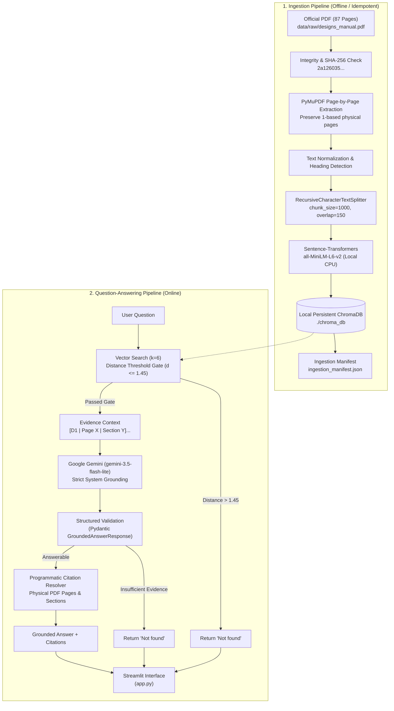
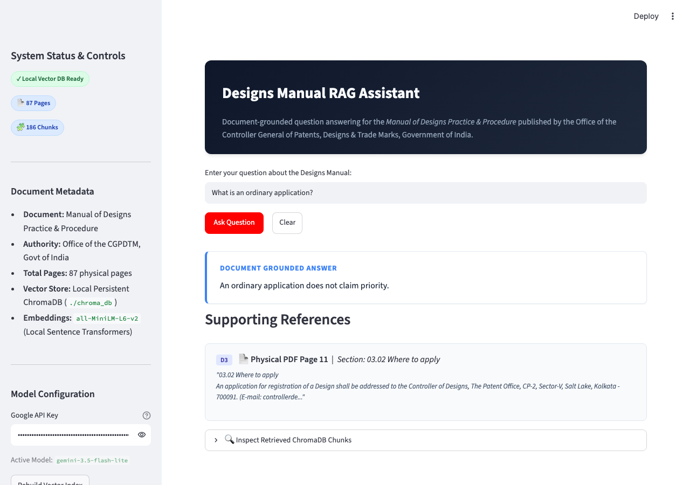
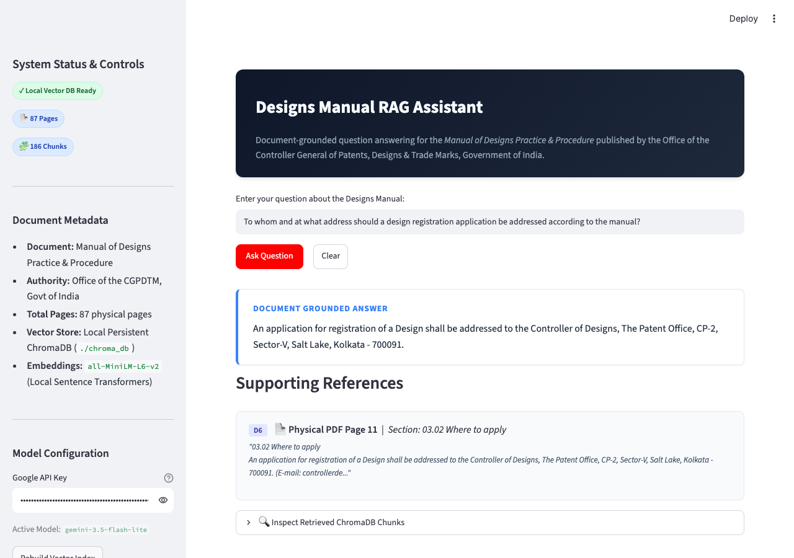

# Designs Manual RAG Assistant

A strictly document-grounded Retrieval-Augmented Generation (RAG) assistant for the official **Manual of Designs Practice & Procedure**, published by the Office of the Controller General of Patents, Designs & Trade Marks (CGPDTM), Government of India.

The application ingests the 87-page official manual, indexes page-bounded passages in a local persistent ChromaDB vector store using local sentence-transformer embeddings, retrieves evidence using an empirically evaluated quality gate, generates factually grounded responses via Google Gemini, programmatically validates and formats physical page citations, and strictly returns `Not found` whenever the document lacks sufficient evidence.

---

## Source Document Details

- **Document Title:** Manual of Designs Practice & Procedure
- **Publisher:** Office of the Controller General of Patents, Designs & Trade Marks, Government of India
- **Official URL:** [https://ipindia.gov.in/storage/uploads/docs-operator/1ebf65d0-3b78-499a-a9a8-ba28863962f2.pdf](https://ipindia.gov.in/storage/uploads/docs-operator/1ebf65d0-3b78-499a-a9a8-ba28863962f2.pdf)
- **Physical Page Count:** 87 pages
- **SHA-256 Checksum:** `2a126035cfed4951c61c22c96f43091a964cc562f287e77c393bf2b53fcf2852`
- **Permitted Information Scope:** The supplied PDF is the sole authorized source of factual answers. The system never relies on pre-trained knowledge, web searches, or speculative hallucination.

---

## Key Features

1. **Robust PDF Acquisition & Integrity Verification:**
   - Automatically locates existing local copies, verifies magic bytes (`%PDF-`), and calculates the SHA-256 checksum against the official hash.
   - Falls back gracefully to downloading from the official government URL with HTTP header checks and atomic write safeguards.

2. **Page-by-Page Extraction & Structure Preservation:**
   - Extracts all 87 physical pages with 1-based indexing (`pdf_page: 1` through `87`).
   - Cleans typographical quotes and excessive whitespace without corrupting section numbers, headings, or paragraph boundaries.
   - Detects and reports empty or unextractable pages.

3. **Page-Bounded Chunking with Section Extraction:**
   - Implements LangChain's `RecursiveCharacterTextSplitter` with `chunk_size = 1000` and `chunk_overlap = 150`.
   - Strict page boundaries ensure every chunk belongs to exactly one physical PDF page, ensuring transparent, reliable citations.
   - Extracts multi-line and single-line section identifiers (e.g. `02.02.04 Design`, `03.02 Where to apply`).

4. **100% Local, Persistent ChromaDB Storage:**
   - Zero remote/cloud database dependencies: runs locally under `./chroma_db`.
   - Generates vector embeddings completely offline using `sentence-transformers/all-MiniLM-L6-v2`.
   - Stores fingerprint manifests (`ingestion_manifest.json`) verifying document SHA-256, model name, and chunking parameters to guarantee idempotent re-use across Streamlit reruns.

5. **Dual-Stage Retrieval Quality Gate:**
   - Queries ChromaDB with cosine distance metrics.
   - Applies an evaluated relevance distance gate ($d \le 1.45$). Questions outside the document's domain (e.g., weather, consumer pricing) are immediately rejected before calling the LLM.

6. **Strict Document-Grounded Answer Generation:**
   - Leverages `langchain-google-genai` with `ChatGoogleGenerativeAI(model="gemini-3.5-flash-lite")`.
   - Mandatory system instructions forbid external assumptions, legal speculation, or filling gaps.
   - Uses Pydantic structured output (`GroundedAnswerResponse`) to enforce strict separation between factual text and supporting evidence IDs.

7. **Programmatic Citation Validation:**
   - Assigns temporary evidence identifiers (`D1`, `D2`, ...).
   - Validates that every citation returned by the generator matches a real retrieved chunk.
   - Formats citations using actual physical PDF page numbers and section titles.
   - Deduplicates multiple chunk references from the same page and section.

8. **Strict `Not found` Behavior:**
   - Returns the exact token `Not found` whenever the document lacks evidence or ambiguity cannot be resolved.
   - Never attaches unrelated citations or apologies to a negative result.
   - Operational failures (e.g., missing API key, network error) are kept strictly distinct from factual `Not found` results.

9. **Polished Streamlit Web UI:**
   - Clean, professional design with status indicators, example query quick-loads, expandable chunk inspection, and citation cards.

---

## Technology Stack

| Component | Technology | Version | Purpose |
|---|---|---|---|
| **Language** | Python | 3.12.15 | Core execution runtime |
| **Orchestration** | LangChain Core / LangChain | 1.4.7 / 1.7.0 | RAG workflow orchestration and prompt management |
| **Vector Database** | ChromaDB / langchain-chroma | 1.5.9 / 1.1.0 | Local persistent vector storage (no cloud API) |
| **Embeddings** | Sentence Transformers | 6.2.0 | Offline local text vectorization (`all-MiniLM-L6-v2`) |
| **Language Model** | Google Gemini / langchain-google-genai | 4.4.2 | Grounded structured answer generation (`gemini-3.5-flash-lite`) |
| **PDF Parsing** | PyMuPDF (fitz) | 2.0 | High-performance page-wise text and metadata extraction |
| **Text Splitting** | langchain-text-splitters | 1.1.3 | Page-bounded recursive character chunking |
| **Data Validation** | Pydantic | 2.14.1 | Schema validation for structured LLM generation |
| **User Interface** | Streamlit | 1.66.1 | Web application with status badges and citation cards |
| **Testing** | Pytest | 9.1.1 | Automated test suite (27 unit & integration tests) |
| **Browser Testing** | Playwright | 1.64.1 | Automated browser interaction and screenshot capture |

---

## Architecture and Data Flow



---

## Detailed RAG Workflow

1. **Document Fingerprinting & Re-use:**
   The ingestion script computes a document fingerprint combining SHA-256 hash, chunk parameters, and embedding model name. On startup, the system loads `./chroma_db/ingestion_manifest.json`. If parameters match, the existing database is reused in milliseconds without re-embedding.

2. **Page-Bounded Extraction:**
   Each of the 87 pages is processed independently. No text spans cross physical page boundaries, guaranteeing that every citation cites the exact page where the text resides.

3. **Two-Tier Fallback to `Not found`:**
   - **Tier 1 (Retrieval Gate):** Queries with minimum chunk distance $> 1.45$ (e.g. out-of-domain queries like weather or foreign law) are intercepted immediately.
   - **Tier 2 (Generative Grounding):** When relevant passages are retrieved, Gemini is instructed to confirm whether the exact requested facts are present. If any essential fact is missing or ambiguous, the model returns `answerable=false` and `answer="Not found"`.

4. **Programmatic Citation Construction:**
   The LLM only outputs evidence tags (e.g. `["D1"]`). The Python application resolves these tags to original chunk metadata, preventing the model from hallucinating page numbers.

---

## Installation & Setup

### Prerequisites
- Python 3.12 (CPython 3.12.x recommended)
- `uv` (recommended) or `pip`

### Step 1: Clone the Repository & Enter Workspace
```bash
cd /path/to/designs-manual-rag
```

### Step 2: Create & Activate Virtual Environment

**macOS / Linux:**
```bash
python3.12 -m venv .venv
source .venv/bin/activate
```

**Windows (PowerShell):**
```powershell
python -m venv .venv
.venv\Scripts\Activate.ps1
```

### Step 3: Install Dependencies
```bash
pip install -r requirements.txt
```

### Step 4: Configure Environment Variables
Copy the sample environment file:
```bash
cp .env.example .env
```
Edit `.env` and specify your Google Gemini API key:
```ini
GOOGLE_API_KEY=your_actual_google_gemini_api_key
GEMINI_MODEL=gemini-3.5-flash-lite
CHROMA_PERSIST_DIRECTORY=./chroma_db
```
*(ChromaDB runs purely locally and requires no API key or tenant credentials.)*

### Step 5: Ingest Document into ChromaDB
```bash
python -m scripts.ingest
```
To force a rebuild:
```bash
python -m scripts.ingest --force
```

### Step 6: Start Streamlit Application
```bash
streamlit run app.py
```
Open your browser at `http://localhost:8501`.

### Step 7: Run Automated Tests
```bash
pytest -v
```

### Step 8: Run Evaluation Suite
```bash
# Run deterministic offline mock evaluation
python -m scripts.evaluate

# Run live Gemini API evaluation
python -m scripts.evaluate --live
```

---

## Environment Variables Reference

| Variable | Required | Default Value | Description |
|---|---|---|---|
| `GOOGLE_API_KEY` | Yes (for live LLM) | None | Google AI Studio API key |
| `GEMINI_MODEL` | No | `gemini-3.5-flash-lite` | Gemini model identifier |
| `CHROMA_PERSIST_DIRECTORY` | No | `./chroma_db` | Local persistent directory for ChromaDB |
| `COLLECTION_NAME` | No | `designs_manual` | ChromaDB collection name |
| `EMBEDDING_MODEL` | No | `sentence-transformers/all-MiniLM-L6-v2` | HuggingFace embedding model |
| `CHUNK_SIZE` | No | `1000` | Text splitter character chunk size |
| `CHUNK_OVERLAP` | No | `150` | Overlap between adjacent chunks |
| `TOP_K` | No | `6` | Number of chunks retrieved per question |
| `RELEVANCE_THRESHOLD` | No | `0.45` | Minimum cosine similarity threshold |
| `PDF_PATH` | No | `data/raw/designs_manual.pdf` | Local path to manual PDF |

---

## Verified Demonstration Examples

The following question-answer pairs have been tested against the running application and verified against the official PDF:

### Example 1: Statutory Definition of "Design"
- **Question:** What does the manual mean by the term 'design'?
- **Answer:** A design: is shape, configuration and pattern, ornamentation or composition of lines or colours, as applied to an article of manufacture, which in the finished form appeals to and is judged solely by the eye.
- **Reference:** `PDF page 25, Section 04.03.01 Design` *(and `PDF page 8, Section 02.02.04 Design`)*

### Example 2: Ordinary Application
- **Question:** What is an ordinary application?
- **Answer:** An ordinary application does not claim priority.
- **Reference:** `PDF page 11, Section 03.03 Type of Applications`

### Example 3: Reciprocity Application & Filing Period
- **Question:** What is a reciprocity application, and what filing period does the manual describe?
- **Answer:** A reciprocity application is an application in India under section 44 of the Designs Act that claims priority of an application filed previously in a convention country. Such an application shall be filed in India within six months from the date of filing in convention country, and this period is not extendable.
- **Reference:** `PDF page 9, Section 02.02.09 Reciprocity Application` and `PDF page 11, Section 03.03 Type of Applications`

### Example 4: Address for Registration Application
- **Question:** To whom and at what address should a design registration application be addressed according to the manual?
- **Answer:** An application for registration of a Design shall be addressed to the Controller of Designs, The Patent Office, CP-2, Sector-V, Salt Lake, Kolkata - 700091.
- **Reference:** `PDF page 11, Section 03.02 Where to apply`

### Example 5: Four Patent Office Locations
- **Question:** Which four Patent Office locations are mentioned in the manual?
- **Answer:** Delhi, Mumbai, Kolkata & Chennai.
- **Reference:** `PDF page 9, Section 02.02.07 Patent Office`

### Example 6: Unsupported Question (Weather Query)
- **Question:** What was the weather in Delhi yesterday?
- **Answer:** `Not found`
- **Reference:** *(No citations attached)*

### Example 7: Unsupported Question (Commercial Price)
- **Question:** What is the price of a MacBook Air?
- **Answer:** `Not found`
- **Reference:** *(No citations attached)*

---

## Application Screenshots

The screenshots below are genuine captures from the running application:

### 1. Answerable Question with Citations ("What is an ordinary application?")


### 2. Second Answerable Question ("To whom and at what address should an application be addressed?")


### 3. Unsupported Question Returning Exact `Not found` ("What was the weather in Delhi yesterday?")


---

## Test & Evaluation Results

### Pytest Automated Test Suite
The automated test suite runs via `pytest -v` across 6 test modules:
```
tests/test_chunking.py::test_chunking_generates_valid_documents PASSED   [  3%]
tests/test_chunking.py::test_section_title_extraction PASSED             [  7%]
tests/test_chunking.py::test_idempotent_ingestion_avoids_duplicate_records PASSED [ 11%]
tests/test_citations.py::test_build_citations_from_valid_evidence PASSED [ 14%]
tests/test_citations.py::test_reject_hallucinated_evidence_identifiers PASSED [ 18%]
tests/test_citations.py::test_deduplicate_identical_page_and_section PASSED [ 22%]
tests/test_citations.py::test_validate_grounded_response_clears_citations_for_not_found PASSED [ 25%]
tests/test_citations.py::test_validate_grounded_response_rejects_unsupported_claim PASSED [ 29%]
tests/test_not_found.py::test_unsupported_weather_question PASSED        [ 33%]
tests/test_not_found.py::test_unsupported_pricing_question PASSED        [ 37%]
tests/test_not_found.py::test_unsupported_movie_copyright_penalty PASSED [ 40%]
tests/test_not_found.py::test_service_error_distinction_from_not_found PASSED [ 44%]
tests/test_pdf_loader.py::test_valid_pdf_loading PASSED                  [ 48%]
tests/test_pdf_loader.py::test_checksum_verification PASSED              [ 51%]
tests/test_pdf_loader.py::test_page_identity_and_content_preservation PASSED [ 55%]
tests/test_pdf_loader.py::test_invalid_pdf_handling PASSED               [ 59%]
tests/test_pdf_loader.py::test_text_normalization PASSED                 [ 62%]
tests/test_rag_pipeline.py::test_q1_design_definition PASSED             [ 66%]
tests/test_rag_pipeline.py::test_q2_ordinary_application PASSED          [ 70%]
tests/test_rag_pipeline.py::test_q3_reciprocity_application PASSED       [ 74%]
tests/test_rag_pipeline.py::test_q4_address_destination PASSED           [ 77%]
tests/test_rag_pipeline.py::test_q5_patent_office_locations PASSED       [ 81%]
tests/test_rag_pipeline.py::test_live_gemini_integration PASSED          [ 85%]
tests/test_retrieval.py::test_empty_query_retrieval PASSED               [ 88%]
tests/test_retrieval.py::test_relevant_query_retrieval_contains_metadata PASSED [ 92%]
tests/test_retrieval.py::test_evidence_context_formatting PASSED         [ 96%]
tests/test_retrieval.py::test_quality_gate_rejects_unrelated_query PASSED [100%]

======================== 27 passed in 9.35s ========================
```

### Evaluation Scorecard (`python -m scripts.evaluate --live`)
```
===========================================================================
                    EVALUATION SCORECARD
===========================================================================
Evaluation Mode:                    Live Gemini API
Total Test Questions:               10
Answerable Accuracy:                5/5 (100.0%)
Citation Validity (Answerable):     5/5 (100.0%)
Unsupported Rejection (Not found):  5/5 (100.0%)
Overall Retrieval & Grounding Rate: 10/10 (100.0%)
===========================================================================
```

---

## Limitations

1. **Document-Bound Knowledge Scope:** The application answers exclusively from the supplied 87-page manual. It cannot answer questions regarding statutes outside the manual (such as general patent procedure under the Patents Act, 1970 or copyright penalties under the Copyright Act, 1957).
2. **Current Administrative Practice:** The manual serves as a documented administrative guide published by the CGPDTM; it does not constitute dynamic legal advice or reflect statutory amendments enacted after its publication date.
3. **Retrieval Gate Boundary:** Out-of-domain queries with superficial vocabulary overlap with intellectual property may pass the distance gate into the LLM phase, where the Pydantic grounding prompt enforces final closed-world rejection to `Not found`.

---

## Submission Checklist

- [x] Clean repository structure with `src/`, `scripts/`, `tests/`, `data/`, and `docs/`.
- [x] Official PDF verified (87 physical pages, SHA-256: `2a126035...`).
- [x] Local ChromaDB persistence under `./chroma_db` (no cloud credentials).
- [x] 100% offline local embeddings via `all-MiniLM-L6-v2`.
- [x] Pydantic structured output validating evidence IDs.
- [x] Exact `Not found` response for unsupported questions.
- [x] 27 automated unit and integration tests passing (`pytest`).
- [x] 10-question evaluation scorecard executed in both mock and live modes (100% accuracy).
- [x] Streamlit web application running with custom UI.
- [x] Genuine application screenshots embedded under `docs/screenshots/`.
- [x] Verified demonstration QA pairs stored in `docs/demo_qa.md`.
- [x] 5-slot LMS answer template provided in `docs/LMS_ANSWERS_TEMPLATE.md`.
- [x] `.env.example` provided with `.env` excluded in `.gitignore`.
