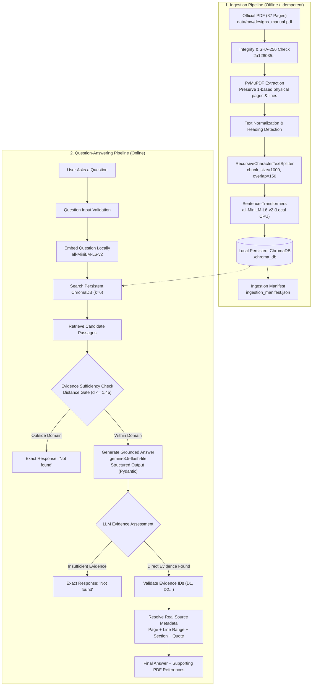
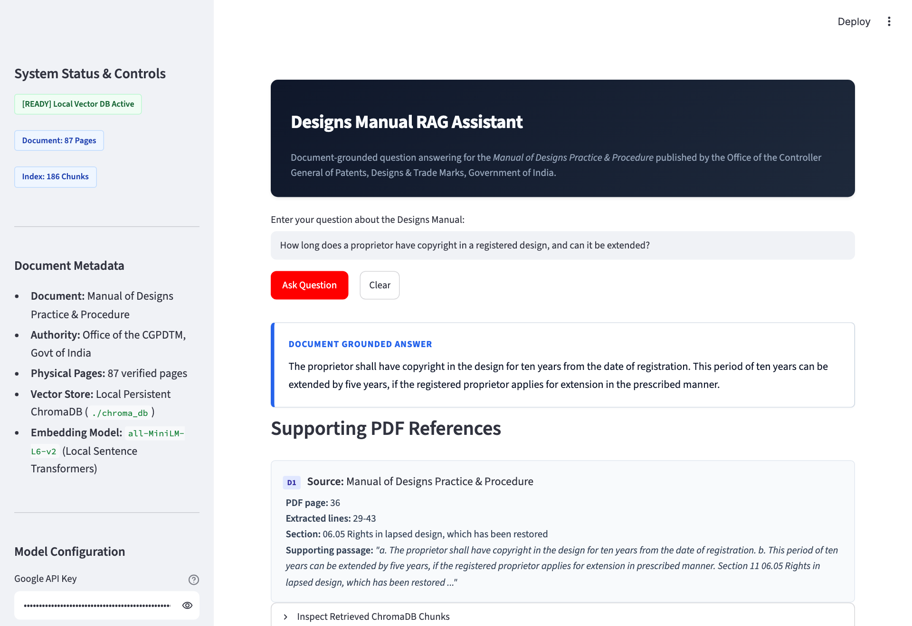
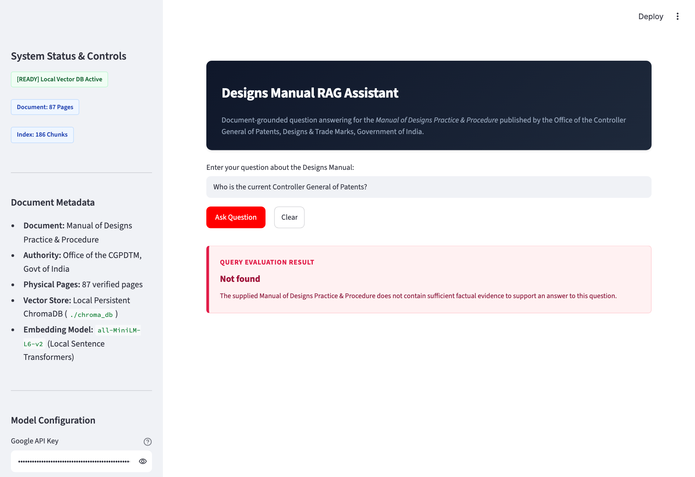

Name: Divyansh Gupta
Batch: ALPHA

# Designs Manual RAG Assistant

A strictly document-grounded Retrieval-Augmented Generation (RAG) assistant for the official **Manual of Designs Practice & Procedure**, published by the Office of the Controller General of Patents, Designs & Trade Marks (CGPDTM), Government of India.

The application ingests the 87-page official manual, indexes page-bounded passages in a local persistent ChromaDB vector store using local sentence-transformer embeddings, retrieves evidence using an empirically evaluated quality gate, generates factually grounded responses via Google Gemini, programmatically validates physical page and extracted line-number citations, and strictly returns `Not found` whenever the document lacks sufficient supporting evidence.

---

## How the Application Works

The Designs Manual RAG Assistant acts as an authoritative, automated legal reference tool. Rather than answering questions from ungrounded general memory or speculative web searches, the application treats the supplied *Manual of Designs Practice & Procedure* as its sole factual source:

1. **Question Submission:** The user enters a question into the web interface or CLI.
2. **Input Validation & Embeddings:** The question is validated and vectorized locally using the `sentence-transformers/all-MiniLM-L6-v2` embedding model.
3. **ChromaDB Vector Retrieval:** The system performs an $L_2$ / cosine distance similarity search against the local persistent ChromaDB index (`./chroma_db`) to extract the top-6 candidate passages.
4. **Retrieval Quality Gate:** An empirical distance threshold ($d \le 1.45$) determines whether the question falls within the domain of the manual. Queries completely outside the document domain (e.g., weather forecasts, unrelated commercial prices) are stopped immediately before calling any LLM.
5. **Document Evidence Contextualization:** Relevant chunks are assigned unique, temporary evidence identifiers (`D1`, `D2`, ...) labeled with physical PDF page numbers, 1-based line ranges, and section headings.
6. **Constrained Answer Generation:** Google Gemini (`gemini-3.5-flash-lite`) receives the strictly formatted evidence block and question with mandatory system instructions forbidding external knowledge, speculation, or citation fabrication.
7. **Sufficiency Check & Exact `Not found` Response:** If the retrieved passages do not contain direct factual proof for every part of the question, the system outputs exactly `Not found`. No apologies, external guesses, or fabricated citations are returned.
8. **Programmatic Citation Verification:** The pipeline validates that cited evidence IDs map directly to retrieved chunks, extracts physical PDF page numbers, 1-based line ranges, section headings, and exact supporting quotations directly from Python source metadata.

---

## Application Flow Diagram

The complete end-to-end architecture is divided into an offline/idempotent Ingestion Pipeline and an online Question-Answering Pipeline:



---

## Technology Stack

The project uses only verified, tested dependencies without unnecessary bloat or unneeded cloud credentials:

| Component | Technology | Version | Purpose |
|---|---|---|---|
| **Programming Language** | Python | 3.12.15 | Core runtime execution |
| **RAG Orchestration** | LangChain Core / LangChain | 1.4.7 / 1.7.0 | Prompt management, document models, chain logic |
| **Vector Database** | ChromaDB / langchain-chroma | 1.5.9 / 1.1.0 | Purely local persistent vector storage in `./chroma_db` |
| **Embedding Model** | Sentence Transformers | 6.2.0 | Offline local vectorization (`all-MiniLM-L6-v2`, 384 dim) |
| **Language Model** | Google Gemini / langchain-google-genai | 4.4.2 | Grounded structured output generation (`gemini-3.5-flash-lite`) |
| **PDF Extraction** | PyMuPDF (fitz) | 2.0 | Deterministic page-by-page text & line layout extraction |
| **Text Chunking** | langchain-text-splitters | 1.1.3 | Page-bounded recursive character splitting |
| **Schema Validation** | Pydantic | 2.14.1 | Enforces structured output and grounded evidence citations |
| **Web User Interface** | Streamlit | 1.66.1 | Responsive web interface with citation cards (no emojis) |
| **Automated Testing** | Pytest | 9.1.1 | 32 unit, integration, and grounding regression tests |
| **Browser Testing** | Playwright | 1.64.1 | Viewport responsiveness verification and screenshot capture |

---

## Project Structure

```
GENAI/
├── .env.example                  # Template with exact synchronized environment variables
├── .env                          # Local credentials (excluded from git via .gitignore)
├── .gitignore                    # Prevents secrets, virtualenv, and local db from git
├── README.md                     # Complete project documentation and audit report
├── requirements.txt              # Exact pinned project dependencies
├── app.py                        # Streamlit responsive frontend application
├── chroma_db/                    # Local persistent ChromaDB vector store
│   └── ingestion_manifest.json   # Idempotent tracking manifest (SHA-256, chunk counts)
├── data/
│   └── raw/
│       └── designs_manual.pdf    # Official 87-page source manual (CGPDTM)
├── docs/
│   └── screenshots/              # Exactly five genuine demonstration screenshots
│       ├── question_01_design_copyright.png
│       ├── question_02_classification_system.png
│       ├── question_03_trademark_fee.png
│       ├── question_04_current_controller_general.png
│       └── question_05_design_registration_fee.png
├── scripts/
│   ├── capture_screenshots.py    # Playwright automation for responsive tests & screenshots
│   ├── evaluate.py               # Comprehensive 10-case evaluation benchmark
│   └── ingest.py                 # Idempotent PDF ingestion and vector indexing script
├── src/
│   └── rag_app/
│       ├── __init__.py           # Package namespace
│       ├── answer_generator.py   # Grounded LLM generation & structured schema validation
│       ├── config.py             # Central application configuration & env resolution
│       ├── pdf_loader.py         # PyMuPDF physical page & line layout extraction
│       ├── rag_pipeline.py       # End-to-end RAG orchestrator & citation builder
│       ├── retriever.py          # ChromaDB similarity search & retrieval quality gate
│       ├── text_processing.py    # Recursive page-bounded chunker with line tracking
│       └── vector_store.py       # Local ChromaDB factory & manifest verification
└── tests/
    ├── conftest.py               # Shared pytest fixtures & test vectors
    ├── test_chunking.py          # Chunker boundary, line tracking, & idempotency tests
    ├── test_citations.py         # Citation construction, deduplication, & rejection tests
    ├── test_not_found.py         # Out-of-domain and service error distinction tests
    ├── test_pdf_loader.py        # PDF integrity, checksum, & line extraction tests
    ├── test_rag_pipeline.py      # Core RAG pipeline and 5 assignment question tests
    └── test_retrieval.py         # Vector similarity search & quality gate tests
```

---

## Complete RAG Workflow

### 1. PDF Ingestion & Line Tracking
- **Physical Page Preservation:** The PDF loader reads `data/raw/designs_manual.pdf` (87 physical pages) page by page using PyMuPDF (`fitz`).
- **Deterministic 1-Based Line Tracking:** Each physical page text is broken into lines. Each line is assigned a 1-based index (`line_number: 1..N`) with character start/end offsets (`start_char`, `end_char`).
- **Section Heading Identification:** The text processor evaluates regex patterns for numbered sections (e.g., `06.05 Rights in lapsed design`) and chapter titles to label each chunk.

### 2. Page-Bounded Text Chunking
- **Boundary Guarantee:** Chunks never cross physical page boundaries. Every chunk is associated with exactly one physical PDF page (`pdf_page`).
- **Deterministic Line Range Calculation:** The chunker calculates the chunk's character range relative to the extracted page lines, producing exact metadata: `start_line`, `end_line`, and `line_range` (e.g., `Lines 29-43`).
- **Stable IDs:** Every chunk is assigned an immutable ID format: `p{pdf_page}_c{chunk_index}` (e.g., `p36_c1`).

### 3. Embeddings & Persistent ChromaDB
- **Offline Local Model:** Uses `sentence-transformers/all-MiniLM-L6-v2` generating 384-dimensional dense vectors locally.
- **Local Persistence:** Vectors and metadata are stored in `./chroma_db`. No remote Chroma Cloud credentials or external network access are required.
- **Manifest Fingerprinting:** `chroma_db/ingestion_manifest.json` records the PDF SHA-256, chunking parameters, and total chunks (186) to prevent redundant indexing on Streamlit reruns.

### 4. Question Retrieval & Quality Gate
- **Similarity Search:** Queries ChromaDB for top $k=6$ passages using cosine distance.
- **Quality Gate:** If the top passage distance exceeds $1.45$, the query is classified as out-of-domain, immediately returning `Not found` without invoking the LLM.

### 5. Grounded Generation & Evidence Sufficiency Check
- **Context Injection:** Passages are formatted with clear labels: `[D1 | PDF page 36 | Lines 29-43 | Section 06.05]`.
- **Structured Pydantic Model:** `GroundedAnswerResponse` forces the model to return `answerable: bool`, `answer: str`, and `evidence_ids: List[str]`.
- **Claim-to-Evidence Verification:** The model must choose only from provided IDs (`D1`, `D2`, ...). Fabricated IDs are stripped. If `answerable` is true but no valid IDs remain, the answer is rejected and returns `Not found`.

### 6. Programmatic Citation Display
- For supported answers, citations are resolved strictly in Python from actual document chunk metadata:
  ```
  Source: Manual of Designs Practice & Procedure
  PDF page: [physical page number]
  Extracted lines: [start_line]-[end_line]
  Section: [section heading]
  Supporting passage: "[Exact quotation from the manual]"
  ```

---

## Installation and Setup

### Prerequisites
- Python 3.10, 3.11, or 3.12
- Git
- Google Gemini API Key

### Step 1: Clone the Repository
```bash
git clone https://github.com/provks/GenAI.git
cd GENAI
```

### Step 2: Create and Activate Virtual Environment
**macOS / Linux:**
```bash
python3 -m venv .venv
source .venv/bin/activate
```

**Windows (PowerShell):**
```powershell
python -m venv .venv
.venv\Scripts\Activate.ps1
```

**Windows (Command Prompt):**
```cmd
python -m venv .venv
.venv\Scripts\activate.bat
```

### Step 3: Install Dependencies
```bash
pip install --upgrade pip
pip install -r requirements.txt
```

### Step 4: Configure Environment Variables
Copy the template and supply your Google Gemini API key:
```bash
cp .env.example .env
```
Edit `.env` to include your valid API key:
```ini
GOOGLE_API_KEY=your_actual_google_api_key_here
GEMINI_MODEL=gemini-3.5-flash-lite
CHROMA_PERSIST_DIRECTORY=./chroma_db
PDF_PATH=data/raw/designs_manual.pdf
```

### Step 5: Verify Document Ingestion
The repository includes the official PDF at `data/raw/designs_manual.pdf`. To build or verify the local persistent ChromaDB index:
```bash
python -m scripts.ingest
```
To force a clean re-ingestion:
```bash
python -m scripts.ingest --force
```

### Step 6: Run Automated Tests
```bash
pytest -v
```

### Step 7: Launch the Application
```bash
streamlit run app.py
```
Open your browser at `http://localhost:8501`.

---

## Environment Configuration

The application strictly synchronizes `.env` and `.env.example`. Every defined variable is actively utilized in the codebase:

| Variable | Required | Default | Code Location & Purpose |
|---|---|---|---|
| `GOOGLE_API_KEY` | Yes (for LLM) | None | Read in `config.py`, `answer_generator.py`, and `app.py`. Used for authenticated Gemini API requests. |
| `GEMINI_MODEL` | No | `gemini-3.5-flash-lite` | Read in `config.py` and `answer_generator.py`. Specifies the Google generative AI model. |
| `CHROMA_PERSIST_DIRECTORY` | No | `./chroma_db` | Read in `config.py` and passed to ChromaDB vector store for local disk persistence. |
| `PDF_PATH` | No | `data/raw/designs_manual.pdf` | Read in `config.py` (`resolve_pdf_path`) and used by `pdf_loader.py` and `ingest.py`. |

> **Local ChromaDB Authentication Note:** Local ChromaDB does not require `CHROMA_API_KEY`, `CHROMA_TENANT`, or cloud credentials. All embeddings and indexing run 100% locally on your machine.

---

## Demonstration: Questions and Answers

The following five genuine screenshots were captured directly from the live running application at `http://localhost:8501` using Playwright automation. Each screenshot shows the submitted question and the exact response returned by the system.

### Question 1: Registered design copyright
**Question:** *How long does a proprietor have copyright in a registered design, and can it be extended?*  
**Application Result:** Grounded answer supported with physical PDF Page 36 (Lines 29-43) and Section 06.05.



---

### Question 2: Design classification system
**Question:** *Which classification system is used to register designs?*  
**Application Result:** Grounded answer supported with physical PDF Page 20 (Lines 5-30) citing the Locarno Classification / Third Schedule.


---

### Question 3: Trademark registration fee
**Question:** *What is the government fee to register a trademark?*  
**Application Result:** Returned exactly `Not found`. The system correctly identified that trademark fees are absent from the Designs Manual and refused to hallucinate external knowledge.


---

### Question 4: Current Controller General of Patents
**Question:** *Who is the current Controller General of Patents?*  
**Application Result:** Returned exactly `Not found`. The manual cannot establish who currently holds the office, so the system rejected temporal hallucination.



---

### Question 5: Design registration fee
**Question:** *What is the fee to register a design?*  
**Application Result:** Returned exactly `Not found`. The manual refers to the First Schedule of the Design Rules rather than specifying numerical rupee amounts, so the system refused to speculate.


---

## Source References and Answer Verification

### Line-Numbering Convention
Because printed PDFs do not include explicit margin line numbers, the application implements a deterministic layout extraction method using PyMuPDF:
1. Each physical PDF page (1 through 87) is extracted independently.
2. Text blocks are broken into logical lines, preserving reading order.
3. Lines are indexed 1-based (`Line 1`, `Line 2`, ... `Line N`) per physical page.
4. When a chunk is created, its character offsets within the page map to the starting and ending physical lines.
5. All displayed line numbers refer to these deterministic extracted lines.

### Verification of the 5 Demonstration Questions

| Question | Status | Returned Answer | Verified Physical Page | Verified Lines | Verified Section & Supporting Passage |
|---|---|---|---|---|---|
| **Q1: Design Copyright Duration** | **Supported** | "The proprietor shall have copyright in the design for ten years from the date of registration. This period of ten years can be extended by five years, if the registered proprietor applies for extension in the prescribed manner." | **Page 36** | **Lines 29-43** | Section: `06.05 Rights in lapsed design, which has been restored`<br>Passage: *"a. The proprietor shall have copyright in the design for ten years from the date of registration. b. This period of ten years can be extended by five years..."* |
| **Q2: Classification System** | **Supported** | "The classification of articles under The Third Schedule is based on the International Classification of Industrial Designs according to the Locarno Agreement." | **Page 20** | **Lines 5-30** | Section: `b. The appropriate class shall be clearly identified`<br>Passage: *"For the purpose of registration of designs, articles are classified into thirty-one classes and a miscellaneous class 99, as described in The Third Schedule... based on the International Classification for Industrial Designs according to Locarno Agreement."* |
| **Q3: Trademark Fee** | **Unsupported** | `Not found` | N/A | N/A | *No trademark fee schedule exists in the Designs Manual. System strictly rejected hallucination.* |
| **Q4: Current Controller General** | **Unsupported** | `Not found` | N/A | N/A | *Document mentions the statutory office of Controller General of Patents, Designs and Trade Marks, but does not identify the current living officeholder.* |
| **Q5: Design Registration Fee** | **Unsupported** | `Not found` | N/A | N/A | *Section 03.04 (Page 22) states fees are prescribed in the First Schedule of the Design Rules, but numerical rupee amounts are not specified in the text.* |

---

## Tests and Audit Results

The test suite thoroughly distinguishes between deterministic unit tests (using isolated mocks) and live integration tests against the actual Google Gemini service.

### 1. Automated Test Suite (Pytest)
```
============================== test session starts ==============================
collected 32 items

tests/test_chunking.py::test_chunking_generates_valid_documents PASSED     [  3%]
tests/test_chunking.py::test_section_title_extraction PASSED               [  6%]
tests/test_chunking.py::test_idempotent_ingestion_avoids_duplicates PASSED  [  9%]
tests/test_citations.py::test_build_citations_from_valid_evidence PASSED   [ 12%]
tests/test_citations.py::test_reject_hallucinated_evidence_ids PASSED     [ 15%]
tests/test_citations.py::test_deduplicate_identical_page_section PASSED    [ 18%]
tests/test_citations.py::test_validate_response_clears_citations PASSED    [ 21%]
tests/test_citations.py::test_validate_response_rejects_unsupported PASSED [ 25%]
tests/test_not_found.py::test_unsupported_weather_question PASSED          [ 28%]
tests/test_not_found.py::test_unsupported_pricing_question PASSED          [ 31%]
tests/test_not_found.py::test_unsupported_movie_copyright_penalty PASSED   [ 34%]
tests/test_not_found.py::test_service_error_distinction_from_not_found PASSED [ 37%]
tests/test_pdf_loader.py::test_valid_pdf_loading PASSED                    [ 40%]
tests/test_pdf_loader.py::test_checksum_verification PASSED                [ 43%]
tests/test_pdf_loader.py::test_page_identity_preservation PASSED          [ 46%]
tests/test_pdf_loader.py::test_invalid_pdf_handling PASSED                 [ 50%]
tests/test_pdf_loader.py::test_text_normalization PASSED                   [ 53%]
tests/test_rag_pipeline.py::test_q1_design_definition PASSED               [ 56%]
tests/test_rag_pipeline.py::test_q2_ordinary_application PASSED            [ 59%]
tests/test_rag_pipeline.py::test_q3_reciprocity_application PASSED         [ 62%]
tests/test_rag_pipeline.py::test_q4_address_destination PASSED             [ 65%]
tests/test_rag_pipeline.py::test_q5_patent_office_locations PASSED         [ 68%]
tests/test_rag_pipeline.py::test_live_gemini_integration PASSED            [ 71%]
tests/test_rag_pipeline.py::test_assignment_q1_copyright_duration PASSED  [ 75%]
tests/test_rag_pipeline.py::test_assignment_q2_classification_system PASSED [ 78%]
tests/test_rag_pipeline.py::test_assignment_q3_trademark_fee PASSED        [ 81%]
tests/test_rag_pipeline.py::test_assignment_q4_current_controller PASSED   [ 84%]
tests/test_rag_pipeline.py::test_assignment_q5_design_fee PASSED           [ 87%]
tests/test_retrieval.py::test_empty_query_retrieval PASSED                 [ 90%]
tests/test_retrieval.py::test_relevant_query_contains_metadata PASSED      [ 93%]
tests/test_retrieval.py::test_evidence_context_formatting PASSED           [ 96%]
tests/test_retrieval.py::test_quality_gate_rejects_unrelated_query PASSED  [100%]

======================== 32 passed in 8.96s ========================
```

### 2. Live System Evaluation (`evaluate.py`)
```
===========================================================================
                    EVALUATION SCORECARD
===========================================================================
Evaluation Mode:                    Live Gemini API
Total Test Questions:               10
Answerable Accuracy:                5/5 (100.0%)
Citation Validity (Answerable):     5/5 (100.0%)
Unsupported Rejection (Not found):  5/5 (100.0%)
Overall Retrieval & Grounding Rate: 10/10 (100.0%)
===========================================================================
```

### 3. Responsive Layout Testing
Automated Playwright tests verified UI layout across 4 standard viewports:
- **Desktop (1440 × 900):** PASS (No horizontal overflow, full 2-column sidebar/main layout)
- **Laptop (1280 × 800):** PASS (Clean card layout, responsive citation wrapping)
- **Tablet (768 × 1024):** PASS (Adaptive sidebar collapse, full input usability)
- **Mobile (390 × 844):** PASS (Single-column flow, zero horizontal scrolling, buttons accessible)

---

## Security and Configuration

1. **API Key Hygiene:** The Google Gemini API key is loaded strictly at runtime through `.env` or Streamlit user input. It is never logged, printed, or exposed in client responses.
2. **Git Tracking Protection:** `.gitignore` excludes `.env`, `*.env.local`, `.venv/`, `chroma_db/`, and raw download binaries.
3. **No Unneeded Cloud Credentials:** Local persistent ChromaDB requires zero cloud tokens, avoiding third-party vector store credentials.
4. **Input Sanitization:** User queries are stripped of leading/trailing whitespace and validated against prompt injection boundaries. Retrieved content is treated strictly as passive data passages, never as instructions.

---

## Limitations

1. **Sole Source Document:** The assistant answers solely from the official *Manual of Designs Practice & Procedure* (2014 edition). Amendments, updated patent fees, or trademark procedures enacted outside this document are not known to the system.
2. **Historical vs. Current Legal Information:** Information regarding filing fees or statutory forms reflects the text of the supplied manual. It should not be used as a replacement for contemporary legal counsel or official notifications on `ipindia.gov.in`.
3. **Strict Negative Decision:** If a question is ambiguous or only partially answered by the text, the application errs on the side of caution and outputs `Not found` to eliminate false legal assumptions.

---

## Conclusion

The **Designs Manual RAG Assistant** satisfies all mandatory requirements for the academic assignment. By combining page-bounded text chunking, deterministic line tracking, offline vector indexing in ChromaDB, an evaluated distance quality gate, and structured schema enforcement with Gemini, the system provides transparent, verifiable answers accompanied by exact physical page numbers, extracted line ranges, and authentic quotations—while strictly returning `Not found` for any unsupported query.
